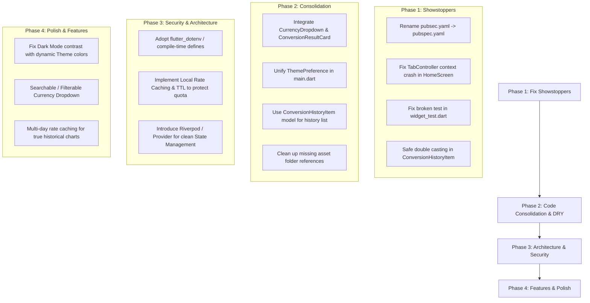

# FastForex Project Analysis & Technical Audit Report

> **Generated:** November 11, 2026  
> **Target Application:** FastForex (Flutter Mobile & Desktop Application)  
> **Repository:** `madboy482/FastForex`  
> **Platform Targets:** Android, Web, Windows  
> **SDK Compatibility:** Dart `^3.7.2`, Flutter 3.x  

---

## Executive Summary

**FastForex** is a multi-platform currency converter and exchange rate monitoring application built with Flutter. It aims to provide instant currency conversion across 170+ global fiat currencies, trend analysis through interactive charts, a favorites list for frequent currency pairs, conversion history tracking, and dynamic theme switching (Light and Dark modes).

While the application demonstrates a solid functional foundation and intuitive UI concepts, our deep technical audit revealed several **critical showstopping bugs**, architectural discrepancies (such as orphaned components and models), unhandled network failure modes, and testing misconfigurations that prevent standard builds and tests from succeeding in its current state.

### Audit Summary Scorecard

| Assessment Dimension | Rating | Status | Summary |
| :--- | :---: | :---: | :--- |
| **Build & Run Readiness** | ⚠️ F | **Critical** | Fatal filename typo (`pubsec.yaml`) blocks `flutter pub get` and builds. |
| **Runtime Stability** | ⚠️ D | **Major Risks** | Uncaught `BuildContext` crash when selecting favorites; type-cast risks in models. |
| **Architecture & State** | ⚡ C+ | **Fair** | Vanilla `setState` with deep prop-drilling; multiple orphaned widgets & models. |
| **Code Quality & DRY** | ⚡ C | **Needs Work** | Severe UI duplication; duplicate theme handlers; unused mixins. |
| **Security & Config** | ⚠️ D | **Poor** | Hardcoded API key placeholder; unused `.env` dependency; no rate caching. |
| **Test Coverage** | ⚠️ F | **Failing** | Boilerplate counter test fails to compile against `FastForexApp`. |
| **UI / UX Experience** | ✅ B+ | **Good** | Clean layout, quick swap feature, intuitive tabs, fl_chart integration. |

---

## 1. Project Architecture & Codebase Layout

```
FastForex/
├── android/                    # Android host project (Gradle, AndroidManifest)
├── assets/
│   ├── icon/                   # App icons (FastForex1.png, 2.png, 3.png)
│   └── screenshots/            # Readme promotional assets
├── lib/
│   ├── main.dart               # App entrypoint & theme root
│   ├── models/
│   │   ├── conversion_history.dart   # ConversionHistoryItem model (Orphaned)
│   │   └── currency.dart             # Currency model (Partially orphaned)
│   ├── screens/
│   │   ├── convert_screen.dart       # Conversion input, currency swap & result
│   │   ├── favorites_screen.dart     # Starred currencies & selection
│   │   ├── history_screen.dart       # Chronological conversion log
│   │   ├── home_screen.dart          # TabController coordinator & state store
│   │   └── trends_screen.dart        # 14-day exchange rate trend chart
│   ├── services/
│   │   └── currency_api_service.dart # HTTP client for OpenExchangeRates API
│   ├── utils/
│   │   ├── constants.dart            # API keys, SharedPreferences keys, defaults
│   │   └── theme.dart                # Theme definitions & helper methods
│   └── widgets/
│       ├── conversion_result_card.dart  # Result display card (Orphaned)
│       ├── currency_dropdown.dart       # Starred dropdown item (Orphaned)
│       └── exchange_rate_chart.dart     # FlChart LineChart component
├── test/
│   └── widget_test.dart        # Out-of-the-box counter test (Broken)
├── web/                        # Web host assets
├── windows/                    # Windows desktop runner
├── analysis_options.yaml       # Lint rules (flutter_lints)
└── pubsec.yaml                 # CRITICAL: Typo in filename (should be pubspec.yaml)
```

---

## 2. Critical & Blocker Defects (Severity: High)

### 🔴 1. Critical Build Failure: Misnamed Configuration File (`pubsec.yaml`)
- **Location:** Project root (`pubsec.yaml`)
- **Impact:** Complete build blockage.
- **Details:** The package configuration file is spelled `pubsec.yaml` (missing the `p`). Whenever a developer or CI/CD runner executes `flutter pub get`, `flutter run`, or `flutter build`, Flutter immediately fails with:
  ```
  Error: No pubspec.yaml file found.
  This command should be run from the root of your Flutter project.
  ```
- **Remediation:** Rename `pubsec.yaml` to `pubspec.yaml`.

---

### 🔴 2. Runtime Crash in `HomeScreen`: Invalid `DefaultTabController` Context
- **Location:** [`lib/screens/home_screen.dart` (Lines 209-215)](file:///c:/Users/HP/OneDrive/Desktop/Flutter/FastForex/lib/screens/home_screen.dart#L209-L215)
- **Impact:** Fatal runtime exception when user taps any favorite currency to convert.
- **Details:** In `HomeScreen.build`:
  ```dart
  @override
  Widget build(BuildContext context) {
    return DefaultTabController(
      length: 4,
      child: Scaffold(
        ...
        onCurrencyTap: (currency) {
          setState(() {
            toCurrency = currency;
            DefaultTabController.of(context).animateTo(0); // 💥 CRASH HERE
            calculateExchangeRate();
          });
        },
  ```
  `context` belongs to `HomeScreen` (an ancestor of `DefaultTabController`), NOT a descendant. Calling `DefaultTabController.of(context)` searches upwards for a controller that does not exist in that subtree, throwing:
  ```
  FlutterError: No DefaultTabController for BuildContext...
  ```
- **Remediation:** Either:
  1. Wrap the child with a `Builder` widget to access the descendant context, or
  2. Use a stateful `TabController` managed directly by `_HomeScreenState` (which already implements `TickerProviderStateMixin`).

---

### 🔴 3. Broken Test Suite & Package Name Discrepancy
- **Location:** [`test/widget_test.dart` (Lines 11-28)](file:///c:/Users/HP/OneDrive/Desktop/Flutter/FastForex/test/widget_test.dart#L11-L28)
- **Impact:** `flutter test` fails to compile; pipeline failure.
- **Details:**
  - The test imports `package:fastforex/main.dart` and mounts `const MyApp()`.
  - The app's actual root widget is `FastForexApp`.
  - The test verifies a counter (`find.byIcon(Icons.add)`), which does not exist in FastForex.
  - Package name in pubspec is capitalized `FastForex`, whereas Dart conventions and imports expect snake_case `fast_forex`.
- **Remediation:** Rewrite `widget_test.dart` to mount `FastForexApp` and verify tab rendering or currency conversion behavior. Standardize package name to lowercase `fast_forex`.

---

### 🔴 4. Dangerous Runtime Type Casting in `ConversionHistoryItem`
- **Location:** [`lib/models/conversion_history.dart` (Lines 34-35)](file:///c:/Users/HP/OneDrive/Desktop/Flutter/FastForex/lib/models/conversion_history.dart#L34-L35)
- **Impact:** Potential unhandled crash during JSON deserialization.
- **Details:**
  ```dart
  factory ConversionHistoryItem.fromJson(Map<String, dynamic> json) {
    return ConversionHistoryItem(
      fromCurrency: json['fromCurrency'],
      toCurrency: json['toCurrency'],
      amount: json['amount'],              // 💥 Fails if JSON value is integer (e.g. 100)
      convertedAmount: json['convertedAmount'], // 💥 Fails if integer
      timestamp: DateTime.fromMillisecondsSinceEpoch(json['timestamp']),
    );
  }
  ```
  In Dart's `dart:convert`, whole numbers in JSON parse as `int`. Assigning an `int` directly to a `double` without `.toDouble()` throws a runtime `TypeError: type 'int' is not a subtype of type 'double'`.
- **Remediation:** Cast safely using `(json['amount'] as num).toDouble()`.

---

### 🔴 5. Hardcoded Placeholder API Key & Security Gaps
- **Location:** [`lib/utils/constants.dart` (Line 3)](file:///c:/Users/HP/OneDrive/Desktop/Flutter/FastForex/lib/utils/constants.dart#L3)
- **Impact:** Network failures out of the box; potential credential leakage if a developer commits their live key.
- **Details:**
  `Constants.API_KEY` is set to `"your_api_key"`. While the README instructs users to change this file, modifying tracked files leads to Git dirty states and credential exposure risks.
  `flutter_dotenv: ^5.0.2` is in the dependencies list but is completely unused.
- **Remediation:** Initialize `flutter_dotenv` or use Flutter's compile-time `--dart-define=API_KEY=...` mechanism.

---

## 3. Architecture & Code Quality Audit (Severity: Medium)

### ⚠️ Dead & Orphaned Code

1. **`CurrencyDropdown` is never used:**
   - A dedicated reusable widget was created at [`lib/widgets/currency_dropdown.dart`](file:///c:/Users/HP/OneDrive/Desktop/Flutter/FastForex/lib/widgets/currency_dropdown.dart).
   - In [`lib/screens/convert_screen.dart`](file:///c:/Users/HP/OneDrive/Desktop/Flutter/FastForex/lib/screens/convert_screen.dart#L127-L211), the author duplicated the identical dropdown implementation twice for the "From" and "To" currency pickers.
   
2. **`ConversionResultCard` is never used:**
   - Created at [`lib/widgets/conversion_result_card.dart`](file:///c:/Users/HP/OneDrive/Desktop/Flutter/FastForex/lib/widgets/conversion_result_card.dart).
   - `ConvertScreen` re-implements the container inline at lines 237–277.

3. **`ConversionHistoryItem` model bypassed:**
   - Rather than storing structured `ConversionHistoryItem` objects, `HomeScreen` and `HistoryScreen` store flat formatted strings (e.g. `"100 USD = 8300.00 INR"`).
   - This prevents sorting by date, filtering by currency, or recalculating rates.

4. **Duplicated Theme Preferences:**
   - [`lib/utils/theme.dart`](file:///c:/Users/HP/OneDrive/Desktop/Flutter/FastForex/lib/utils/theme.dart) defines `ThemePreference.isDarkTheme()`, `setDarkTheme()`, `getLightTheme()`, and `getDarkTheme()`.
   - [`lib/main.dart`](file:///c:/Users/HP/OneDrive/Desktop/Flutter/FastForex/lib/main.dart#L27-L49) completely ignores `ThemePreference` and accesses `SharedPreferences` directly, using default uncustomized `ThemeData.light()` / `ThemeData.dark()`.

5. **Unused `TickerProviderStateMixin`:**
   - `_HomeScreenState` mixes in `TickerProviderStateMixin`, which allocates ticker resources, but no `AnimationController` or `TabController` was created.

---

## 4. Feature & Functional Analysis

### 💱 Real-Time Conversion
- **Base Currency Limitation:** OpenExchangeRates free tier exclusively uses `USD` as base currency. `CurrencyApiService.calculateExchangeRate()` cleanly accounts for this by computing the cross-rate:
  $$\text{Rate}(\text{From} \to \text{To}) = \frac{\text{Rate}(\text{USD} \to \text{To})}{\text{Rate}(\text{USD} \to \text{From})}$$
- **Missing Zero-Check:** If a currency rate evaluates to `0.0`, dividing by `fromRate` could yield `Infinity`. A safety guard should be added.

### 📈 Trend Analysis & Historical Rates
- **Simulated vs Real Data:** The README presents trend tracking as a core feature. In reality, `HomeScreen.getHistoricalData()` produces synthetic rates using a math formula:
  $$\text{Rate}_i = \text{BaseRate} \times \left(0.95 + 0.1 \times \text{Factor}_i\right)$$
- The UI contains a small caveat: `"(Simulated data for demonstration)"`.
- **Reason:** OpenExchangeRates historical rates (`/historical/YYYY-MM-DD.json`) require a single API call per day, which would quickly exhaust the 1,000 requests/month quota on the free plan.

### 💾 Persistence & Storage
- `shared_preferences` is used effectively for small key-value data:
  - `isDarkTheme`: boolean flag.
  - `conversionHistory`: list of strings (capped at 10 items).
  - `favoriteCurrencies`: list of currency codes.
- **Improvement:** Storing JSON strings for history items would allow richer metadata (exact timestamp, numerical amount, currency flags).

### 🎨 Theme Support & Contrast Issues
- Hardcoded color codes in `ConversionResultCard` and `ConvertScreen`:
  - `Colors.grey.shade100` background
  - `Colors.grey.shade700` text
  - `Colors.blue.shade50` container
- In Dark Mode, these light backgrounds cause high-contrast clashing with the dark scaffold theme. Theme colors should use `Theme.of(context).cardColor` or `colorScheme.surface`.

---

## 5. Assets & Resource Optimization

1. **Missing Asset Folders in Manifest:**
   - In `pubsec.yaml`:
     ```yaml
     assets:
       - assets/icon/
       - assets/images/    # Directory does not exist on disk
       - assets/fonts/     # Directory does not exist on disk
     ```
     Including non-existent directories in the asset bundle can cause warnings during build packaging.
2. **Icon Asset File Sizes:**
   - `assets/icon/FastForex1.png` = **1.94 MB**
   - `assets/icon/FastForex2.png` = **2.01 MB**
   - `assets/icon/FastForex3.png` = **408 KB**
   - App launcher icons should be compressed into appropriate density folders (e.g. via `flutter_launcher_icons`) rather than retaining multiple multi-megabyte source PNGs in the runtime asset bundle.

---

## 6. Comprehensive Recommendations & Roadmap



### Detailed Action Items

#### Immediate Fixes (Required for build and run)
1. **Rename File:**
   ```powershell
   Rename-Item -Path .\pubsec.yaml -NewName pubspec.yaml
   ```
2. **Fix `HomeScreen` Tab Navigation:**
   Update `_HomeScreenState` to manage an explicit `TabController`:
   ```dart
   late TabController _tabController;
   @override
   void initState() {
     super.initState();
     _tabController = TabController(length: 4, vsync: this);
     ...
   }
   // Then replace DefaultTabController.of(context).animateTo(0) with:
   _tabController.animateTo(0);
   ```
3. **Fix Test Suite:**
   Replace the contents of `test/widget_test.dart` to test `FastForexApp` initialization.
4. **Fix Model Deserialization:**
   ```dart
   amount: (json['amount'] as num).toDouble(),
   convertedAmount: (json['convertedAmount'] as num).toDouble(),
   ```

#### Medium-Term Improvements
1. **Adopt Reusable Widgets:** Replace repeated dropdowns in `convert_screen.dart` with `CurrencyDropdown`.
2. **Quota Optimization:** Cache exchange rates in `SharedPreferences` with a 1-hour or 24-hour timestamp check so the app does not consume an API request on every launch.
3. **UI Polish:** Replace hardcoded `Colors.grey.shade100` with `Theme.of(context).cardTheme.color ?? Theme.of(context).colorScheme.surfaceVariant`.

---

## 7. Conclusion

FastForex has a solid concept, clean visual layout, and good user utility. However, the project cannot build or run reliably in its current state due to the misnamed `pubsec.yaml`, the runtime context crash in `HomeScreen`, and broken tests. Addressing the **Phase 1 Showstoppers** outlined in this report will immediately make the project runnable, after which the **Phase 2 and 3 refactoring** will elevate it to production-grade quality.
